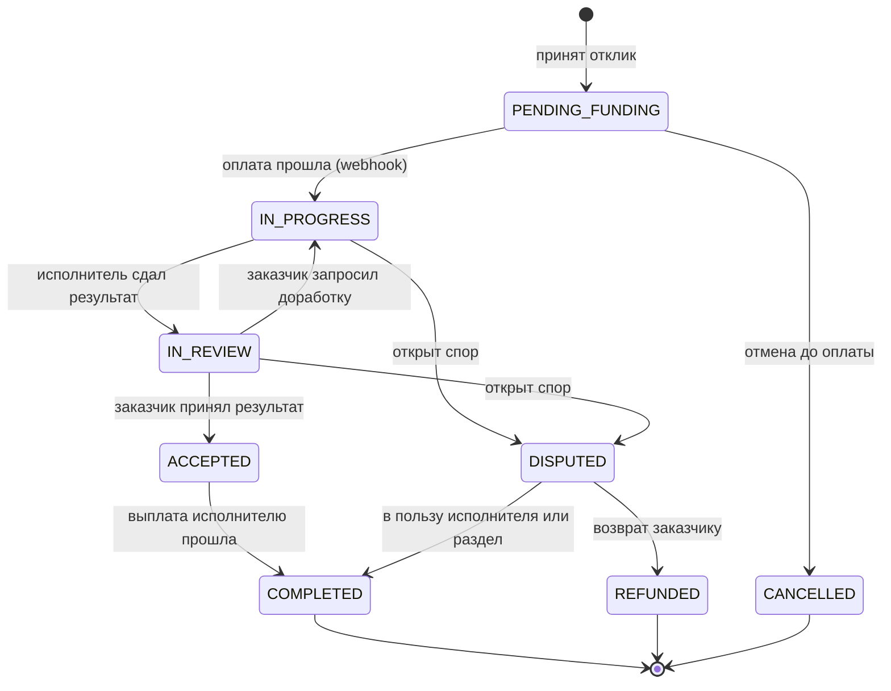
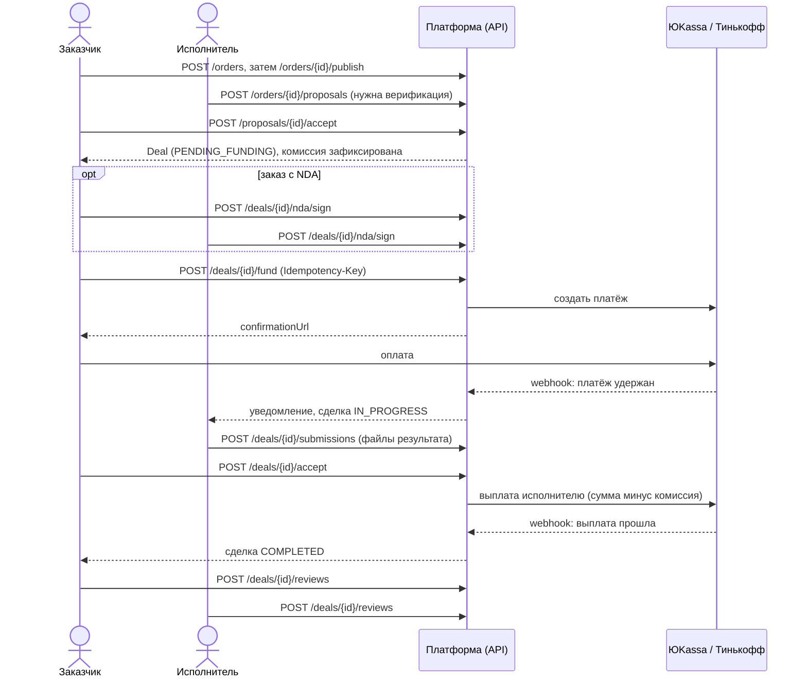
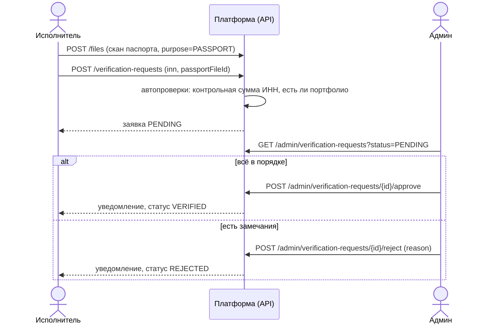
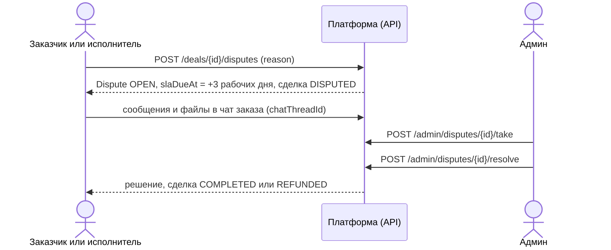

# REST API: B2B-маркетплейс ИТ-услуг с верификацией и эскроу

Описание API для команды разработки и защиты проекта. Формальный контракт — `openapi.yaml` (OpenAPI 3.0.3); интерактивная версия — `api.html`. Таблицы эндпоинтов ниже строятся из спецификации, поэтому с ней не расходятся.

**Объём:** 66 путей, 76 операций, 69 схем. Эндпоинты разложены по тем же вехам, что и миграции БД (V1–V4).

## 1. Общие соглашения

| Тема | Правило |
|---|---|
| Базовый путь | `/api/v1`, JSON (UTF-8) |
| Аутентификация | `Authorization: Bearer <accessToken>` (JWT, TTL 15 мин) |
| Обновление токена | `POST /auth/refresh` с `refreshToken` (stateless JWT, TTL 7 суток). Выход — удаление токенов на клиенте |
| Роли | `CUSTOMER`, `EXECUTOR`, `ADMIN`; роль `ADMIN` через API создать нельзя |
| Идентификаторы | UUID |
| Деньги | число с двумя знаками (`100000.00`), валюта RUB |
| Даты | ISO 8601, UTC |
| Пагинация | `?page=0&size=20&sort=поле,desc`; в ответе `items`, `page`, `size`, `totalItems`, `totalPages` |
| Идемпотентность | операция оплаты `POST /deals/{id}/fund` требует заголовок `Idempotency-Key`; повтор с тем же ключом возвращает тот же платёж |
| Загрузка файлов | сначала `POST /files` (multipart, до 10 МБ), затем в запросах передаётся `fileId` / `fileIds` |

### Формат ошибки

```json
{
  "code": "VALIDATION_ERROR",
  "message": "Некорректные данные запроса",
  "timestamp": "2026-11-01T10:00:00Z",
  "details": [ { "field": "budgetMax", "message": "должно быть не меньше budgetMin" } ]
}
```

| HTTP | `code` | Когда |
|---|---|---|
| 400 | `VALIDATION_ERROR` | неверные данные запроса |
| 400 | `COMMISSION_OUT_OF_RANGE` | ставка комиссии вне диапазона 10–15 % |
| 401 | `UNAUTHORIZED` | нет токена или он недействителен |
| 403 | `FORBIDDEN` | недостаточно прав (чужой объект, не та роль) |
| 403 | `VERIFICATION_REQUIRED` | исполнитель без верификации откликается на заказ |
| 403 | `USER_BLOCKED` | учётная запись заблокирована |
| 404 | `NOT_FOUND` | объект не найден или недоступен |
| 409 | `INVALID_STATE` | действие недопустимо в текущем статусе (например, принять сделку не в `IN_REVIEW`) |
| 409 | `ALREADY_EXISTS` | повторный отклик, отзыв, заявка на верификацию |
| 413 | — | файл больше допустимого размера |
| 502 | `PAYMENT_PROVIDER_ERROR` | ошибка платёжного провайдера |

## 2. Жизненный цикл сделки



Статусы остальных сущностей: заказ — `DRAFT → PUBLISHED → IN_PROGRESS → COMPLETED` (а также `CANCELLED`, `BLOCKED`); отклик — `PENDING → ACCEPTED | REJECTED | WITHDRAWN`; спор — `OPEN → IN_REVIEW → RESOLVED`; заявка на верификацию — `PENDING → APPROVED | REJECTED`.

## 3. Сквозные сценарии

### 3.1. Заказ, сделка, эскроу, приёмка



Если результат не устраивает, вместо `accept` вызывается `POST /deals/{id}/request-revision` — сделка возвращается в `IN_PROGRESS`, исполнитель сдаёт новую версию.

### 3.2. Верификация исполнителя



### 3.3. Спор



Варианты решения: `RELEASE_TO_EXECUTOR` (выплата исполнителю), `REFUND_TO_CUSTOMER` (возврат), `SPLIT` (раздел; `executorAmount + customerAmount` должны равняться сумме сделки, комиссия берётся только с части исполнителя).

## 4. Примеры запросов

### Регистрация заказчика

`POST /auth/register`

```json
{
  "email": "cto@example.com",
  "password": "S3cret-pass",
  "fullName": "Иван Петров",
  "role": "CUSTOMER",
  "company": { "name": "ООО Тест", "inn": "7707083893" }
}
```

Ответ `201`: `{ "tokens": { "accessToken": "…", "refreshToken": "…", "expiresIn": 900 }, "user": { "id": "…", "role": "CUSTOMER", … } }`

### Поиск исполнителей

`GET /executors?skillIds=1,8&verifiedOnly=true&minRating=4&sort=rating,desc&page=0&size=20`

Ответ `200` (фрагмент):

```json
{
  "items": [{
    "userId": "3fa85f64-5717-4562-b3fc-2c963f66afa6",
    "displayName": "Алексей К.",
    "headline": "Senior Java-разработчик",
    "hourlyRate": 3500.00,
    "verificationStatus": "VERIFIED",
    "ratingAvg": 4.8, "ratingCount": 12, "completedDeals": 9,
    "topSkills": [{ "id": 1, "name": "Java", "category": "Backend" }]
  }],
  "page": 0, "size": 20, "totalItems": 1, "totalPages": 1
}
```

### Создание заказа

`POST /orders` (создаётся `DRAFT`, затем `POST /orders/{id}/publish`)

```json
{
  "title": "Доработка REST API на Spring Boot",
  "description": "Нужно добавить эндпоинты и покрыть тестами.",
  "category": "Backend",
  "skillIds": [1, 2],
  "budgetMin": 80000.00,
  "budgetMax": 120000.00,
  "deadlineAt": "2026-12-20",
  "ndaRequired": true
}
```

### Оплата в эскроу

`POST /deals/{dealId}/fund` с заголовком `Idempotency-Key: 6b1f…`

```json
{ "provider": "YOOKASSA", "returnUrl": "https://app.example.com/deals/3fa85f64" }
```

Ответ `201`:

```json
{ "paymentId": "…", "status": "PENDING", "confirmationUrl": "https://sandbox.example/pay/…" }
```

### Сделка (фрагмент ответа)

```json
{
  "id": "…", "status": "PENDING_FUNDING",
  "amount": 100000.00, "currency": "RUB",
  "commissionRate": 12.00, "commissionAmount": 12000.00, "executorPayout": 88000.00,
  "ndaRequired": true, "ndaSignedByBoth": false
}
```

### Решение по спору

`POST /admin/disputes/{id}/resolve`

```json
{ "resolution": "SPLIT", "executorAmount": 60000.00, "customerAmount": 40000.00, "comment": "Выполнено частично." }
```

## 5. Все эндпоинты

### V1 · Ядро (веха до 15.11) — 33 эндпоинтов

**Auth**

| Метод | Путь | Доступ | Назначение |
|---|---|---|---|
| `POST` | `/auth/register` | без JWT | Регистрация заказчика или исполнителя |
| `POST` | `/auth/login` | без JWT | Вход по email и паролю |
| `POST` | `/auth/refresh` | без JWT | Обновление пары токенов |

**Users**

| Метод | Путь | Доступ | Назначение |
|---|---|---|---|
| `GET` | `/users/me` | любой авторизованный | Текущий пользователь |
| `PATCH` | `/users/me` | любой авторизованный | Изменить имя и телефон |
| `POST` | `/users/me/password` | любой авторизованный | Сменить пароль |

**Executors**

| Метод | Путь | Доступ | Назначение |
|---|---|---|---|
| `GET` | `/executors` | любой авторизованный | Поиск исполнителей |
| `GET` | `/executors/{executorId}` | любой авторизованный | Профиль исполнителя (публичная часть) |
| `GET` | `/executors/me` | EXECUTOR | Мой профиль исполнителя |
| `PUT` | `/executors/me` | EXECUTOR | Обновить мой профиль |
| `PUT` | `/executors/me/skills` | EXECUTOR | Заменить список навыков |

**Portfolio**

| Метод | Путь | Доступ | Назначение |
|---|---|---|---|
| `GET` | `/executors/{executorId}/portfolio` | любой авторизованный | Портфолио исполнителя |
| `POST` | `/executors/me/portfolio` | EXECUTOR | Добавить работу в портфолио |
| `PUT` | `/executors/me/portfolio/{itemId}` | EXECUTOR | Изменить работу в портфолио |
| `DELETE` | `/executors/me/portfolio/{itemId}` | EXECUTOR | Удалить работу из портфолио |

**Customers**

| Метод | Путь | Доступ | Назначение |
|---|---|---|---|
| `GET` | `/customers/me` | CUSTOMER | Мой профиль заказчика |
| `PUT` | `/customers/me` | CUSTOMER | Обновить профиль заказчика и данные компании |

**Skills**

| Метод | Путь | Доступ | Назначение |
|---|---|---|---|
| `GET` | `/skills` | любой авторизованный | Справочник навыков |

**Files**

| Метод | Путь | Доступ | Назначение |
|---|---|---|---|
| `POST` | `/files` | любой | Загрузить файл |
| `GET` | `/files/{fileId}` | владелец, участники, ADMIN | Скачать файл |

**Orders**

| Метод | Путь | Доступ | Назначение |
|---|---|---|---|
| `GET` | `/orders` | любой авторизованный | Лента опубликованных заказов |
| `POST` | `/orders` | CUSTOMER | Создать заказ (черновик) |
| `GET` | `/orders/my` | CUSTOMER | Мои заказы |
| `GET` | `/orders/{orderId}` | любой (черновик — владелец) | Карточка заказа |
| `PUT` | `/orders/{orderId}` | CUSTOMER (владелец) | Изменить заказ |
| `POST` | `/orders/{orderId}/publish` | CUSTOMER (владелец) | Опубликовать заказ |
| `POST` | `/orders/{orderId}/cancel` | CUSTOMER (владелец) | Отменить заказ |

**Deals**

| Метод | Путь | Доступ | Назначение |
|---|---|---|---|
| `GET` | `/commission/current` | любой авторизованный | Текущая ставка комиссии платформы |

**Admin**

| Метод | Путь | Доступ | Назначение |
|---|---|---|---|
| `GET` | `/admin/users` | ADMIN | Список пользователей |
| `POST` | `/admin/users/{userId}/block` | ADMIN | Заблокировать пользователя |
| `POST` | `/admin/users/{userId}/unblock` | ADMIN | Разблокировать пользователя |
| `POST` | `/admin/orders/{orderId}/block` | ADMIN | Заблокировать заказ (модерация) |
| `PUT` | `/admin/commission` | ADMIN | Установить ставку комиссии платформы |

### V2 · Сделки (веха до 29.11) — 24 эндпоинтов

**Proposals**

| Метод | Путь | Доступ | Назначение |
|---|---|---|---|
| `GET` | `/orders/{orderId}/proposals` | CUSTOMER (владелец) | Отклики на заказ |
| `POST` | `/orders/{orderId}/proposals` | EXECUTOR (VERIFIED) | Откликнуться на заказ |
| `GET` | `/proposals/my` | EXECUTOR | Мои отклики |
| `POST` | `/proposals/{proposalId}/withdraw` | EXECUTOR (автор) | Отозвать отклик |
| `POST` | `/proposals/{proposalId}/reject` | CUSTOMER (владелец заказа) | Отклонить отклик |
| `POST` | `/proposals/{proposalId}/accept` | CUSTOMER (владелец заказа) | Принять отклик и создать сделку |

**Deals**

| Метод | Путь | Доступ | Назначение |
|---|---|---|---|
| `GET` | `/deals` | CUSTOMER, EXECUTOR | Мои сделки |
| `GET` | `/deals/{dealId}` | участники сделки | Карточка сделки |
| `GET` | `/deals/{dealId}/nda` | участники сделки | NDA по сделке |
| `POST` | `/deals/{dealId}/nda/sign` | участники сделки | Подписать NDA (электронное согласие стороны) |
| `GET` | `/deals/{dealId}/submissions` | участники сделки | История сдачи результата |
| `POST` | `/deals/{dealId}/submissions` | EXECUTOR (сделки) | Сдать результат на приёмку |
| `POST` | `/deals/{dealId}/accept` | CUSTOMER (сделки) | Принять результат |
| `POST` | `/deals/{dealId}/request-revision` | CUSTOMER (сделки) | Запросить доработку |
| `POST` | `/deals/{dealId}/cancel` | участники сделки | Отменить сделку до оплаты |

**Chat**

| Метод | Путь | Доступ | Назначение |
|---|---|---|---|
| `GET` | `/chats` | участники диалогов | Мои диалоги |
| `POST` | `/chats` | CUSTOMER, EXECUTOR | Открыть диалог по заказу (получить существующий или создать) |
| `GET` | `/chats/{threadId}/messages` | участники диалога | Сообщения диалога |
| `POST` | `/chats/{threadId}/messages` | участники диалога | Отправить сообщение |
| `POST` | `/chats/{threadId}/read` | участники диалога | Отметить сообщения собеседника прочитанными |

**Notifications**

| Метод | Путь | Доступ | Назначение |
|---|---|---|---|
| `GET` | `/notifications` | любой авторизованный | Мои уведомления |
| `GET` | `/notifications/unread-count` | любой авторизованный | Количество непрочитанных |
| `POST` | `/notifications/{notificationId}/read` | любой авторизованный | Отметить прочитанным |
| `POST` | `/notifications/read-all` | любой авторизованный | Отметить все прочитанными |

### V3 · Эскроу (веха до 13.12) — 10 эндпоинтов

**Payments**

| Метод | Путь | Доступ | Назначение |
|---|---|---|---|
| `POST` | `/deals/{dealId}/fund` | CUSTOMER (сделки) | Внести оплату в эскроу |
| `GET` | `/deals/{dealId}/payments` | участники сделки | Платежи по сделке (депозит, выплата, возврат) |

**Disputes**

| Метод | Путь | Доступ | Назначение |
|---|---|---|---|
| `POST` | `/deals/{dealId}/disputes` | участники сделки | Открыть спор по сделке |
| `GET` | `/disputes` | участники споров | Мои споры |
| `GET` | `/disputes/{disputeId}` | участники, ADMIN | Карточка спора |

**Webhooks**

| Метод | Путь | Доступ | Назначение |
|---|---|---|---|
| `POST` | `/webhooks/yookassa` | провайдер (подпись/IP) | Уведомление ЮKassa |
| `POST` | `/webhooks/tinkoff` | провайдер (подпись/IP) | Уведомление Тинькофф |

**Admin**

| Метод | Путь | Доступ | Назначение |
|---|---|---|---|
| `GET` | `/admin/disputes` | ADMIN | Очередь споров |
| `POST` | `/admin/disputes/{disputeId}/take` | ADMIN | Взять спор в работу |
| `POST` | `/admin/disputes/{disputeId}/resolve` | ADMIN | Вынести решение по спору |

### V4 · Доверие (веха до 27.12) — 9 эндпоинтов

**Reviews**

| Метод | Путь | Доступ | Назначение |
|---|---|---|---|
| `GET` | `/users/{userId}/reviews` | любой авторизованный | Отзывы о пользователе |
| `POST` | `/deals/{dealId}/reviews` | участники сделки | Оставить отзыв по сделке |

**Verification**

| Метод | Путь | Доступ | Назначение |
|---|---|---|---|
| `POST` | `/verification-requests` | EXECUTOR | Подать заявку на верификацию |
| `GET` | `/verification-requests/me` | EXECUTOR | История моих заявок на верификацию |

**Admin**

| Метод | Путь | Доступ | Назначение |
|---|---|---|---|
| `GET` | `/admin/verification-requests` | ADMIN | Очередь заявок на верификацию |
| `GET` | `/admin/verification-requests/{requestId}` | ADMIN | Заявка на верификацию (с файлами и результатами автопроверок) |
| `POST` | `/admin/verification-requests/{requestId}/approve` | ADMIN | Одобрить заявку |
| `POST` | `/admin/verification-requests/{requestId}/reject` | ADMIN | Отклонить заявку |
| `GET` | `/admin/stats` | ADMIN | Метрики пилота |

## 6. Допущения и открытые вопросы

1. Комиссия удерживается из выплаты исполнителю; заказчик платит ровно `amount`.
2. Откликаться на заказы могут только исполнители со статусом `VERIFIED`. Пока нет миграции V4 (верификации), проверку можно отключить флагом или проставить статус вручную.
3. Как именно реализовать удержание и выплату денег у ЮKassa и Тинькофф (холд, счёт платформы, выплаты), нужно проверить по актуальной документации: у холда есть ограничения по сроку, а выплаты могут быть недоступны в тестовом режиме. Рекомендуется интерфейс `PaymentProvider` с возможностью подменить реализацию заглушкой.
4. Вебхуки проходят без JWT: защита — белый список IP или проверка подписи, повторный запрос статуса платежа у провайдера и идемпотентная обработка по `(provider, event_id)`.
5. Новые сообщения в чате и уведомления в MVP получаются опросом (polling); WebSocket/SSE можно добавить без изменений контракта.
