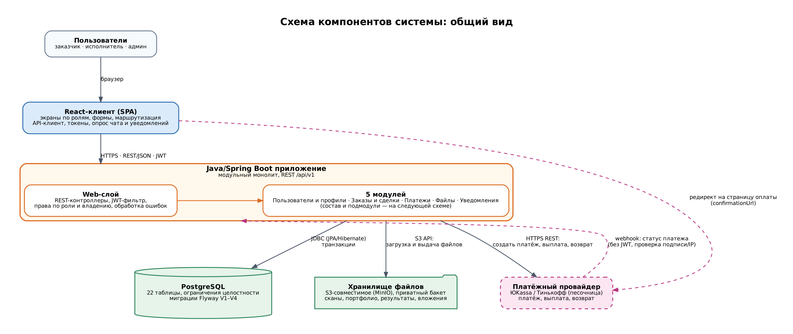
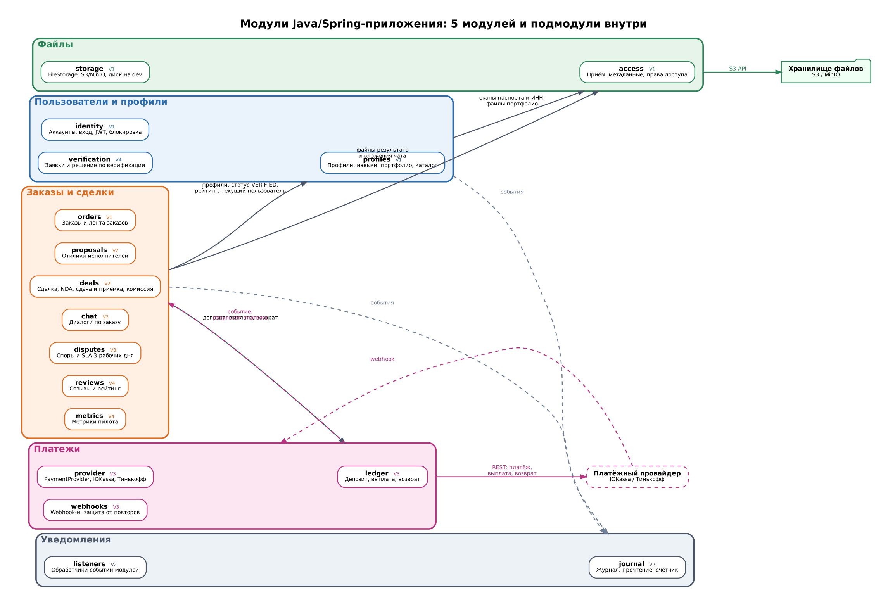
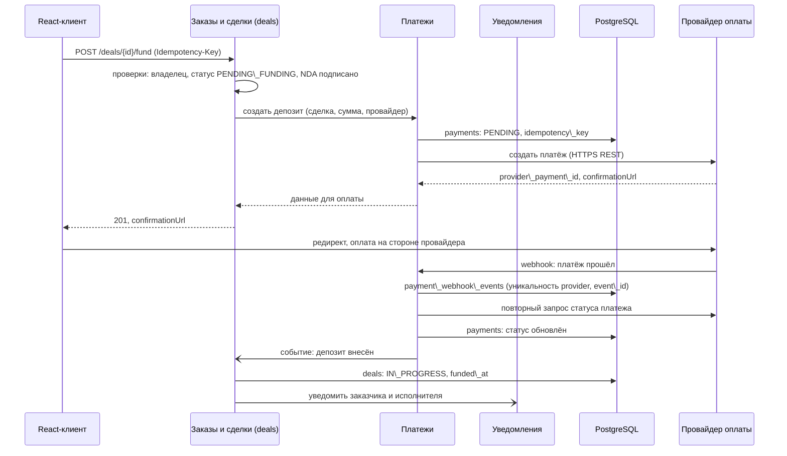
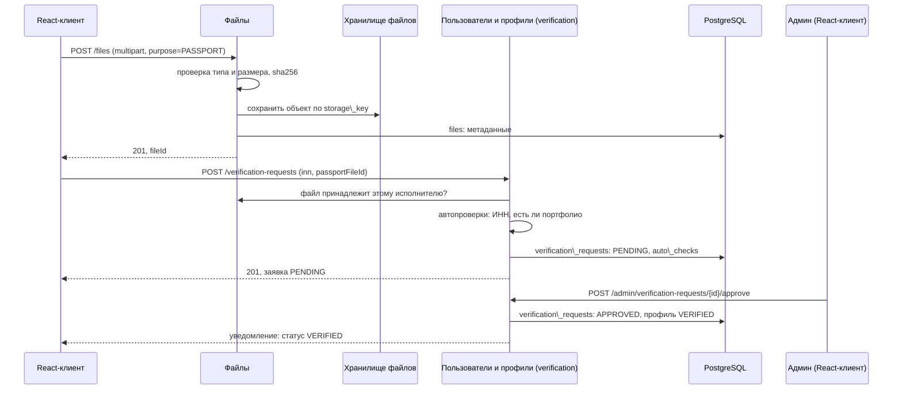

# Компоненты системы и их ответственность

**Проект:** B2B-маркетплейс ИТ-услуг с верификацией и эскроу
**Основа:** ERD (22 таблицы) и OpenAPI (76 операций). Приложение разбито на **5 укрупнённых модулей**, внутри которых выделены подмодули; каждая таблица и каждая операция API отнесены ровно к одному подмодулю (а значит, и модулю), это проверено автоматически, а вызовы между модулями не образуют циклов.

## 1\. Общая схема



Система состоит из пяти компонентов:

|Компонент|Роль в системе|
|-|-|
|React-клиент|интерфейс трёх ролей: заказчик, исполнитель, админ|
|Java/Spring-приложение|вся бизнес-логика, права доступа, интеграции|
|PostgreSQL|долговременное хранение данных и защита их целостности|
|Хранилище файлов|содержимое файлов (сканы, портфолио, результаты работ, вложения)|
|Платёжный провайдер|приём денег, удержание, выплата и возврат|

### 1.1. React-клиент (SPA)

**Назначение.** Единственный пользовательский интерфейс платформы.

**Отвечает за:**

* экраны по ролям: каталог исполнителей и лента заказов, карточки, кабинеты заказчика и исполнителя, страница сделки, чат, уведомления, админ-панель;
* формы и клиентскую валидацию (сервер всё равно проверяет повторно);
* хранение access- и refresh-токенов, автоматическое обновление токена при ответе 401;
* маршрутизацию с защитой по роли;
* загрузку файлов (`POST /files`, multipart) и передачу `fileId` в последующих запросах;
* редирект заказчика на страницу оплаты провайдера (`confirmationUrl`) и обработку возврата на сайт;
* опрос новых сообщений чата и уведомлений каждые 5–10 секунд;
* показ допустимых действий по статусу сделки (кнопки «Оплатить», «Сдать результат», «Принять» и т. д.).

**Не делает:** не принимает бизнес-решений (комиссию и статусы определяет сервер, клиент лишь показывает предварительный расчёт по `GET /commission/current`); не видит и не хранит данные банковских карт (ввод идёт на стороне провайдера); не обращается напрямую к БД и хранилищу файлов.

**Реализация (рекомендация).** React + маршрутизатор; клиент для API можно сгенерировать из `openapi.yaml`.

### 1.2. Java/Spring-приложение

**Назначение.** Единый серверный компонент: модульный монолит с REST API `/api/v1`.

**Отвечает за:**

* аутентификацию (JWT) и авторизацию: роль плюс владение объектом (например, закрыть заказ может только его владелец);
* бизнес-правила и статус-машины: заказ, отклик, сделка, спор, верификация;
* транзакции и согласованность данных (принятие отклика, смена статусов, начисление комиссии);
* интеграцию с платёжными провайдерами и приём их webhook-ов;
* работу с хранилищем файлов;
* фоновые задачи: контроль SLA споров, повторная обработка необработанных webhook-ов;
* применение миграций БД при старте.

**Почему модульный монолит.** Команда из пяти человек и учебные сроки: микросервисы добавили бы сетевое взаимодействие, распределённые транзакции и отдельное развёртывание без выгоды. Модули разделены границами пакетов и интерфейсами, поэтому при необходимости модуль можно выделить в сервис.

**Реализация (рекомендация).** Java 17+, Spring Boot 3 (Web, Security, Data JPA, Validation), Flyway, springdoc-openapi.

### 1.3. PostgreSQL

**Назначение.** Единственное хранилище структурированных данных.

**Отвечает за:**

* хранение 22 таблиц (см. `erd.md`);
* целостность как «последнюю линию защиты» на случай ошибки в коде: внешние ключи, `CHECK` (комиссия 10–15 %, диапазоны оценок), частичные уникальные индексы (одна живая сделка на заказ, один открытый спор на сделку);
* расчёт `commission\_amount` и `executor\_payout` в самой БД (вычисляемые колонки);
* индексы для каталога, ленты заказов и очередей администратора;
* историю структуры через миграции Flyway V1–V4.

**Не делает:** бизнес-логику в триггерах и хранимых процедурах; не хранит содержимое файлов (только метаданные и ключ объекта) и пароли в открытом виде (только хэши).

### 1.4. Хранилище файлов

**Назначение.** Хранение содержимого файлов вне БД.

**Отвечает за:**

* сканы паспорта и ИНН (только тестовые), файлы портфолио, результаты работ, вложения чата;
* приватность: бакет закрыт от публичного доступа, файлы отдаются только через приложение (`GET /files/{id}` после проверки прав);
* устойчивое хранение по ключу `storage\_key` из таблицы `files`.

**Реализация (рекомендация).** S3-совместимое хранилище (MinIO) в контейнере; на локальной разработке допустима папка на диске за тем же интерфейсом `FileStorage`. Сканы паспортов лучше держать под отдельным префиксом с доступом только владельцу и ADMIN. Загрузка и скачивание идут через приложение (так устроен `openapi.yaml`); прямые ссылки на объекты можно добавить позже как оптимизацию.

### 1.5. Платёжный провайдер

**Назначение.** Внешняя система ЮKassa и/или Тинькофф (песочница): единственное место, где обрабатываются деньги и данные карт.

**Отвечает за:**

* страницу оплаты и приём платежа заказчика;
* удержание средств до приёмки результата (эскроу);
* выплату исполнителю и возврат заказчику;
* уведомление платформы о статусе платежа (webhook).

**Взаимодействие.** Приложение работает с провайдером только через интерфейс `PaymentProvider` (создать платёж, получить статус, подтвердить/отменить, выплатить, вернуть): по одной реализации на провайдера и заглушка для тестов. Платформа не принимает на веру тело webhook-а: проверяет подпись или IP и повторно запрашивает статус платежа.

> \*\*Требует проверки.\*\* Как именно удерживать деньги и выплачивать исполнителю (холд карты, зачисление на счёт платформы с отдельной выплатой и т. п.), нужно сверить с актуальной документацией провайдеров: у холда есть ограничения по сроку, а выплаты могут быть недоступны в тестовом режиме. Схема данных от этого не зависит, а интерфейс `PaymentProvider` позволит подменить реализацию.

## 2\. Связи между компонентами

|Откуда → куда|Протокол|Что передаётся|
|-|-|-|
|Пользователь → React-клиент|HTTPS, браузер|страницы и статика|
|React-клиент → приложение|HTTPS, REST/JSON, `Authorization: Bearer`|все операции из `openapi.yaml`|
|Приложение → PostgreSQL|JDBC (JPA/Hibernate), транзакции|чтение и запись таблиц модулей|
|Приложение → хранилище файлов|S3 API|загрузка и выдача объектов|
|Приложение → провайдер|HTTPS REST|создание платежа, запрос статуса, выплата, возврат|
|Провайдер → приложение|HTTPS, webhook, без JWT|уведомление о статусе платежа (`/webhooks/\*`)|
|React-клиент → провайдер|HTTP-редирект браузера|оплата на странице провайдера по `confirmationUrl`|

React-клиент никогда не обращается к PostgreSQL и хранилищу файлов напрямую: всё идёт через приложение, где проверяются права.

## 3\. Модули Java/Spring-приложения

Приложение собрано из пяти укрупнённых модулей. Внутри модуля — подмодули (пакеты Java) с более мелкой разбивкой по ответственности.

|Модуль|Что входит|
|-|-|
|**Пользователи и профили**|Учётные записи, вход, профили, каталог, портфолио, верификация исполнителей|
|**Заказы и сделки**|Заказы, отклики, сделки, NDA, сдача и приёмка, ставка комиссии, споры, чат и отзывы|
|**Платежи**|Интеграция с провайдером, депозит, выплата, возврат, статусы платежей, webhook-и и защита от повторной обработки|
|**Файлы**|Единая точка работы с S3/MinIO, загрузка, скачивание и метаданные файлов|
|**Уведомления**|Журнал уведомлений пользователя, отметка о прочтении и счётчик непрочитанных|



Векторная версия: `components\_modules.svg`. Цвет блока — модуль; метка V1–V4 у подмодуля — миграция БД и веха, в которой он появляется.

### 3.1. Принципы

1. **Модуль владеет своими таблицами** и не читает чужие напрямую. Ссылки на чужие сущности хранятся как UUID, связи JPA через границы модулей не используются.
2. **Снаружи виден один сервис модуля.** Подмодули внутри модуля могут обращаться друг к другу свободно, а другие модули вызывают только публичный сервис модуля; репозитории и сущности остаются внутри.
3. **Зависимости между модулями направлены в одну сторону** (сплошные стрелки на схеме), циклов нет. Обратная связь реализуется событиями: например, «Платежи» не знают о сделках, а публикуют событие о результате платежа.
4. **Права проверяются в сервисах модуля** (роль плюс владение), контроллер только принимает запрос и возвращает ответ.
5. **«Файлы» не зависят от модулей, которые ими пользуются:** правила доступа к файлам регистрируют «Пользователи и профили» и «Заказы и сделки» через интерфейс `FileAccessPolicy`.
6. **Админские эндпоинты (`/admin/\*`) живут в модуле-владельце сущности:** верификация и блокировка пользователей — в «Пользователях и профилях», споры, заказы, комиссия и метрики — в «Заказах и сделках». Отдельного админского модуля нет, роль ADMIN проверяет общий слой безопасности.

Структура пакетов:

```
backend/src/main/java/.../marketplace/
  users/           identity/  profiles/  verification/
  market/          orders/  proposals/  deals/  chat/  disputes/  reviews/  metrics/
  payments/        provider/  ledger/  webhooks/
  files/           storage/  access/
  notifications/   journal/  listeners/
  common/          безопасность, ошибки, пагинация, идемпотентность, планировщик, события
```

Внутри подмодуля обычная раскладка: `controller` → `service` → `repository` и `entity`, плюс `dto`.

### 3.2. Модули подробно

#### Пользователи и профили

Всё, что касается людей на платформе: кто они, как входят, что рассказывают о себе и проверены ли.

|Подмодуль|Ответственность|Таблицы|Операций API|Веха|
|-|-|-|-|-|
|`identity`|Регистрация (заказчик, исполнитель) и вход; выпуск и обновление JWT (access 15 мин, refresh 7 суток, без серверного хранилища); хэши паролей; смена пароля; блокировка и разблокировка (`/admin/users/\*`); «текущий пользователь» для остальных модулей.|`users`|9|V1|
|`profiles`|Профили заказчика (должность, компания) и исполнителя (ставка, доступность, студент); справочник навыков; портфолио; каталог и поиск исполнителей; хранение рейтинга и счётчика сделок (их обновляет модуль «Заказы и сделки»).|`customer\_profiles`, `executor\_profiles`, `skills`, `executor\_skills`, `portfolio\_items`|12|V1|
|`verification`|Заявки на верификацию; автопроверки (контрольная сумма ИНН, наличие портфолио); очередь и решение администратора (`/admin/verification-requests/\*`); обновление статуса исполнителя; время рассмотрения для метрики (цель ≤ 5 мин).|`verification\_requests`|6|V4|

**Итого:** 3 подмодуля, 7 таблиц, 27 операций API. Вызывает: «Файлы». Публикует события для: «Уведомления».

#### Заказы и сделки

Сам рынок: от публикации заказа до завершения сделки и отзыва. Самый крупный модуль: семь подмодулей по этапам жизни сделки.

|Подмодуль|Ответственность|Таблицы|Операций API|Веха|
|-|-|-|-|-|
|`orders`|Заказы: черновик, публикация, редактирование, отмена; лента с фильтрами по навыкам, категории и бюджету; блокировка заказа администратором (`/admin/orders/\*`); смена статуса заказа по ходу сделки.|`orders`, `order\_skills`|8|V1|
|`proposals`|Отклики: создание (только `VERIFIED`-исполнителем, один отклик на заказ), отзыв, отклонение; принятие отклика одной транзакцией закрывает остальные отклики и создаёт сделку.|`proposals`|6|V2|
|`deals`|Центральный подмодуль. Сделка и её статус-машина; фиксация суммы и ставки комиссии; настройки платформы (ставка 10–15 %, `/admin/commission`, `/commission/current`); NDA (снимок текста, подписи); сдача результата, приёмка, доработка, отмена до оплаты; запуск оплаты, выплаты и возврата через модуль «Платежи»; реакция на события платежей.|`deals`, `nda\_agreements`, `deal\_submissions`, `platform\_settings`|13|V2 (ставка — V1, оплата и возврат — V3)|
|`chat`|Диалоги «заказчик ↔ исполнитель» по заказу; сообщения и вложения; отметка «прочитано»; доступ для участников и (в споре) администратора.|`chat\_threads`, `chat\_messages`|5|V2|
|`disputes`|Открытие спора и расчёт срока (SLA 3 рабочих дня); очередь и «взять в работу» (`/admin/disputes/\*`); решение — в пользу исполнителя, возврат или раздел; применение решения через `deals`. Обсуждение ведётся в чате заказа.|`disputes`|6|V3|
|`reviews`|Отзывы по завершённой сделке (по одному от стороны) и их список; пересчёт рейтинга исполнителя через модуль «Пользователи и профили».|`reviews`|2|V4|
|`metrics`|Метрики пилота `/admin/stats`: числа по ролям, сделкам, обороту, комиссии, времени верификации, доле споров в срок. Собственных таблиц нет — агрегирует данные других подмодулей.|—|1|V4|

**Итого:** 7 подмодулей, 11 таблиц, 41 операция API. Вызывает: «Пользователи и профили», «Платежи», «Файлы». Публикует события для: «Уведомления». Слушает события от: «Платежи».

#### Платежи

Единственное место, где система общается с деньгами и платёжными провайдерами. Небольшой по размеру, но самый чувствительный по рискам. Собственных REST-эндпоинтов только два (webhook-и провайдеров): оплата и список платежей по сделке доступны через `deals`, который обращается к этому модулю как к сервису.

|Подмодуль|Ответственность|Таблицы|Операций API|Веха|
|-|-|-|-|-|
|`provider`|Интерфейс `PaymentProvider` (создать платёж, получить статус, подтвердить или отменить, выплатить, вернуть); адаптеры ЮKassa и Тинькофф; заглушка для тестов.|—|0|V3|
|`ledger`|Платежи `DEPOSIT`, `PAYOUT`, `REFUND` и их статусы; идемпотентность по `Idempotency-Key`; публикация события о результате платежа.|`payments`|0|V3|
|`webhooks`|Приём webhook-ов `/webhooks/\*`; проверка подписи или IP; повторный запрос статуса у провайдера; журнал событий; защита от повторной обработки по `(provider, event\_id)`.|`payment\_webhook\_events`|2|V3|

**Итого:** 3 подмодуля, 2 таблицы, 2 операции API. Вызывает: платёжный провайдер (HTTPS REST). Публикует события для: «Заказы и сделки».

#### Файлы

Единая точка работы с содержимым файлов; остальные модули хранят только идентификаторы файлов.

|Подмодуль|Ответственность|Таблицы|Операций API|Веха|
|-|-|-|-|-|
|`storage`|Интерфейс `FileStorage`; реализации для S3/MinIO и для папки на диске (локальная разработка); приватный бакет.|—|0|V1|
|`access`|Приём файлов (тип, размер до 10 МБ, контрольная сумма), метаданные в `files`, выдача после проверки прав. Правила доступа регистрируют сами модули через `FileAccessPolicy`, поэтому «Файлы» ни от кого не зависят.|`files`|2|V1|

**Итого:** 2 подмодуля, 1 таблица, 2 операции API. Вызывает: хранилище файлов (S3 API).

#### Уведомления

Превращает события других модулей в уведомления пользователей.

|Подмодуль|Ответственность|Таблицы|Операций API|Веха|
|-|-|-|-|-|
|`journal`|Журнал уведомлений пользователя; отметка о прочтении («прочитано» и «прочитать все»); счётчик непрочитанных.|`notifications`|4|V2|
|`listeners`|Подписка на события других модулей и превращение их в уведомления; позже — e-mail и push без изменения остальных модулей.|—|0|V2|

**Итого:** 2 подмодуля, 1 таблица, 4 операции API. Вызывает: никого. Слушает события от: «Заказы и сделки», «Пользователи и профили».

### 3.3. Связи между модулями

|Откуда → куда|Тип|Что передаётся|
|-|-|-|
|«Заказы и сделки» → «Пользователи и профили»|вызов сервиса|проверка статуса `VERIFIED` при отклике; данные профилей; обновление рейтинга и счётчика завершённых сделок; текущий пользователь|
|«Заказы и сделки» → «Платежи»|вызов сервиса|создание депозита, выплаты и возврата|
|«Заказы и сделки» → «Файлы»|вызов сервиса|файлы результата работы и вложения чата|
|«Пользователи и профили» → «Файлы»|вызов сервиса|сканы паспорта и ИНН, файлы портфолио|
|«Платежи» ⇢ «Заказы и сделки»|событие|результат платежа: депозит внесён, выплата прошла, возврат выполнен|
|«Заказы и сделки» ⇢ «Уведомления»|событие|смена статусов сделки, отклика, спора, новое сообщение|
|«Пользователи и профили» ⇢ «Уведомления»|событие|решение по заявке на верификацию|

Внешние связи: «Файлы» ↔ хранилище по S3 API; «Платежи» ↔ платёжный провайдер по HTTPS REST (запросы) и webhook (ответные уведомления).

### 3.4. События между модулями

События публикуются внутри приложения (механизм событий Spring); обработчики уведомлений запускаются после фиксации транзакции.

|Событие|Публикует|Обрабатывает|Результат|
|-|-|-|-|
|Депозит внесён / платёж не прошёл|«Платежи» (`ledger`, `webhooks`)|«Заказы и сделки» (`deals`)|сделка `PENDING\_FUNDING → IN\_PROGRESS`, фиксируется `funded\_at`|
|Выплата прошла|«Платежи»|«Заказы и сделки» (`deals`)|сделка `ACCEPTED → COMPLETED`|
|Возврат прошёл|«Платежи»|«Заказы и сделки» (`deals`)|сделка `DISPUTED → REFUNDED`|
|Смена статуса сделки, отклика, спора; новое сообщение|«Заказы и сделки»|«Уведомления» (`listeners`)|запись уведомления пользователю|
|Решение по заявке на верификацию|«Пользователи и профили» (`verification`)|«Уведомления» (`listeners`)|уведомление исполнителю|

## 4\. Как компоненты работают вместе

### 4.1. Оплата в эскроу



Повторный вызов с тем же `Idempotency-Key` возвращает тот же платёж, а повторный webhook отсекается уникальностью `(provider, event\_id)`, поэтому двойных списаний и двойной обработки не будет.

### 4.2. Загрузка файла и верификация исполнителя



## 5\. Сквозные вопросы

**Безопасность**

* Пароли хранятся только в виде хэшей; токены JWT подписываются секретом из окружения, секреты не хранятся в репозитории.
* Каждый запрос проверяется на роль и владение объектом; чужие объекты возвращают `403` или `404`.
* Webhook-и без JWT защищены подписью или белым списком IP, повторным запросом статуса и идемпотентной обработкой.
* Файлы приватны, паспорта доступны только владельцу и ADMIN. Реальные персональные данные в проекте не используются.

**Надёжность**

* Критичные операции (принятие отклика, смена статуса сделки, обработка платежа) выполняются в транзакциях; допустимость переходов статусов проверяет сервер.
* Идемпотентность оплаты и webhook-ов, уникальные индексы в БД как страховка от гонок.
* Планировщик контролирует SLA споров и повторно обрабатывает необработанные webhook-и (`processed\_at IS NULL`).

**Эксплуатация**

* Структурные логи с идентификатором запроса, health-эндпоинт приложения.
* Рекомендуемое развёртывание: Docker Compose с контейнерами `frontend` (nginx со статикой React и проксированием `/api` в приложение, один origin без CORS), `backend`, `postgres`, `minio`; провайдер платежей подключается в песочнице.

## 6\. Соответствие критериям приёмки

|Критерий|Компоненты и модули|
|-|-|
|Верификация (паспорт, ИНН, портфолио) за ≤ 5 мин|React-клиент (форма), «Пользователи и профили» (`verification`, `profiles`), «Файлы», хранилище файлов; время рассмотрения — метрика в «Заказах и сделках» (`metrics`)|
|Эскроу до приёмки, спор ≤ 3 раб. дней|«Заказы и сделки» (`deals`, `disputes`), «Платежи», платёжный провайдер, планировщик SLA|
|Комиссия настраивается в диапазоне 10–15 %|«Заказы и сделки» (`deals`: настройки платформы); ограничение дублируется `CHECK` в PostgreSQL|
|Пилот: ≥ 20 успешных сделок|«Заказы и сделки» (`deals`, `metrics`: `GET /admin/stats`)|

```
