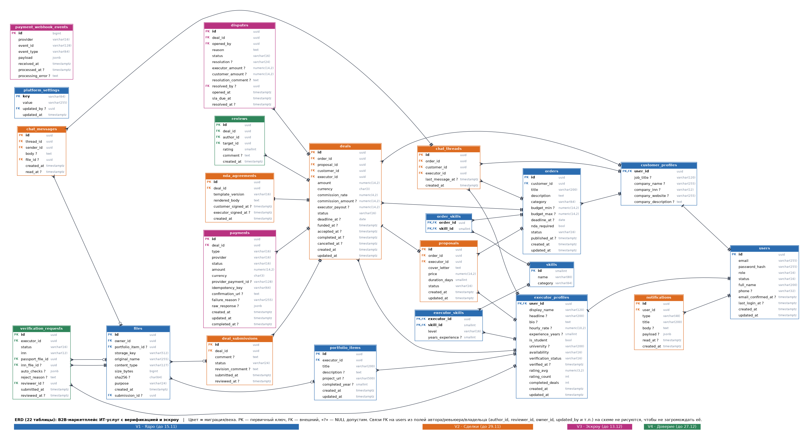
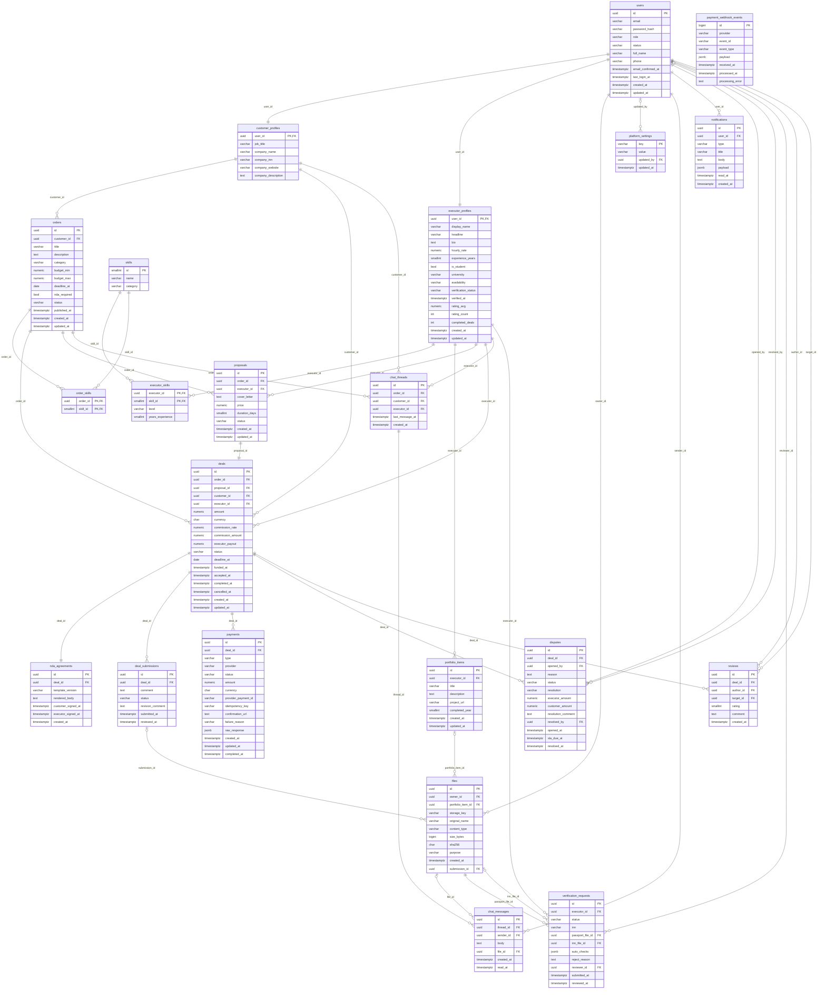

# Проектирование: ERD БД и REST API

**Проект:** B2B-маркетплейс ИТ-услуг с верификацией и эскроу
**Веха:** «Завершение сбора требований и проектирования (ERD, API)» — 01.11.2026
**Стек по паспорту проекта:** Java/Spring + React + PostgreSQL + ЮKassa/Тинькофф (песочница)

## Состав пакета

| Файл | Что внутри |
|---|---|
| `erd.png` / `erd.svg` | ERD: 22 таблицы, 38 внешних ключей; цвет = миграция. Построена из реальной БД |
| `erd.md` | Этот документ + Mermaid-версия ERD |
| `db/migration/V1…V4` | Flyway-миграции PostgreSQL 14+ (применены на PostgreSQL 16) |
| `nda_template.txt` | Текст NDA-шаблона (в ресурсы приложения, не в БД) |
| `openapi.yaml` | OpenAPI 3.0.3: 66 путей, 76 операций, 69 схем (валидирован) |

## Миграции по вехам

| Файл | Веха | Содержание | Таблиц | Эндпоинтов |
|---|---|---|---|---|
| `V1__core.sql` | до 15.11 | Ядро: регистрация, профили, портфолио, заказы | 10 | 33 |
| `V2__deals.sql` | до 29.11 | Сделки: отклики, сделка, NDA, сдача результата, чат, уведомления | 7 | 24 |
| `V3__escrow.sql` | до 13.12 | Эскроу: платежи, webhook-и, споры | 3 | 10 |
| `V4__trust.sql` | до 27.12 | Доверие: верификация, отзывы | 2 | 9 |
| `V1_1__seed_reference_data.sql` | до 15.11 | 28 навыков, ставка комиссии 12 % | — | — |

Порядок применения Flyway: `V1` → `V1.1` → `V2` → `V3` → `V4`. Каждая следующая миграция только **добавляет** таблицы (кроме одной команды `ALTER TABLE files` в V2), поэтому можно спокойно работать на V1 и подключать остальное по мере готовности. Пока нет V4 (верификации), правило «откликаться могут только `VERIFIED`» удобно отключить флагом конфигурации или вручную проставить исполнителям `verification_status = 'VERIFIED'`.

## ERD

**V1__core.sql** — Ядро: регистрация, профили, портфолио, заказы

| Таблица | Назначение |
|---|---|
| `users` | Учётные записи (заказчик, исполнитель, админ) |
| `customer_profiles` | Профиль заказчика (CTO/PM) и данные его компании |
| `executor_profiles` | Профиль исполнителя, статус верификации, рейтинг |
| `skills` | Справочник навыков/технологий |
| `executor_skills` | Навыки исполнителя (M:N) |
| `portfolio_items` | Работы в портфолио исполнителя |
| `files` | Метаданные загруженных файлов |
| `orders` | Заказы заказчиков |
| `order_skills` | Требуемые навыки заказа (M:N) |
| `platform_settings` | Настройки платформы (ставка комиссии 10–15 %) |

**V2__deals.sql** — Сделки: отклики, сделка, NDA, сдача результата, чат, уведомления

| Таблица | Назначение |
|---|---|
| `proposals` | Отклики исполнителей на заказы |
| `deals` | Сделка: заказ + исполнитель + сумма + зафиксированная комиссия |
| `nda_agreements` | NDA по сделке (снимок текста, подписи сторон) |
| `deal_submissions` | Сдача результата по сделке (итерации приёмки) |
| `chat_threads` | Диалоги заказчик ↔ исполнитель по заказу |
| `chat_messages` | Сообщения чата |
| `notifications` | Уведомления пользователей |

**V3__escrow.sql** — Эскроу: платежи, webhook-и, споры

| Таблица | Назначение |
|---|---|
| `payments` | Платежи эскроу: депозит, выплата, возврат |
| `payment_webhook_events` | Журнал webhook-событий ЮKassa/Тинькофф |
| `disputes` | Споры по сделкам (SLA ≤ 3 рабочих дня) |

**V4__trust.sql** — Доверие: верификация, отзывы

| Таблица | Назначение |
|---|---|
| `verification_requests` | Заявки на верификацию (паспорт, ИНН, портфолио) |
| `reviews` | Отзывы и оценки сторон по завершённой сделке |

## Ключевые решения

1. **Сделка — центральная сущность.** Сумма, ставка и выплата фиксируются при создании; `commission_amount` и `executor_payout` вычисляются самой БД (`GENERATED … STORED`), поэтому разойтись не могут. Смена ставки в `platform_settings` на существующие сделки не влияет.
2. **Эскроу = платежи + статусы сделки.** `payments` (`DEPOSIT`, `PAYOUT`, `REFUND`) хранит операции у провайдера, `idempotency_key` защищает от двойных списаний, `payment_webhook_events` с уникальностью `(provider, event_id)` — от повторной обработки уведомлений.
3. **Правила защищены в БД:** комиссия 10–15 % (`CHECK`), одна живая сделка на заказ, один открытый спор на сделку, одна заявка на верификацию в `PENDING`, один отклик на заказ, один отзыв стороны на сделку.
4. **Без реальных ПДн:** номер паспорта не хранится, только тестовый скан в `files`.
5. **Статусы — `VARCHAR + CHECK`, идентификаторы — UUID.**

Для Spring/JPA: для `deals.commission_amount` и `deals.executor_payout` используйте `@Column(insertable = false, updatable = false)`; `rating_avg`, `rating_count`, `completed_deals` обновляйте в той же транзакции, что и отзыв/завершение сделки; `updated_at` — через `@LastModifiedDate` (триггеров нет).

## Трассировка: критерии приёмки → БД и API

| Критерий | Таблицы | Эндпоинты | Миграция |
|---|---|---|---|
| **1.** Верификация (паспорт, ИНН, портфолио) ≤ 5 мин | `verification_requests`, `executor_profiles.verification_status`, `portfolio_items` | `POST /verification-requests`, `/admin/verification-requests/**`, `avgProcessingSeconds` в `GET /admin/stats` | V4 |
| **2.** Эскроу до приёмки; спор ≤ 3 раб. дней | `deals`, `payments`, `payment_webhook_events`, `deal_submissions`, `disputes.sla_due_at` | `POST /deals/{id}/fund`, `/submissions`, `/accept`, `/request-revision`, `/disputes`, `POST /webhooks/*`, `POST /admin/disputes/{id}/resolve` | V2 + V3 |
| **3.** Комиссия настраивается 10–15 % | `platform_settings`, `deals.commission_*` | `GET /commission/current`, `PUT /admin/commission` | V1 + V2 |
| **4.** Пилот: ≥ 20 сделок, 50+ исполнителей, 10+ заказчиков | `deals`, профили | `GET /admin/stats` | V4 |
| NDA-шаблоны | `nda_agreements` + `nda_template.txt` | `/deals/{id}/nda`, `/deals/{id}/nda/sign` | V2 |
| Рейтинги | `reviews`, `executor_profiles.rating_*` | `/deals/{id}/reviews`, `/users/{id}/reviews` | V4 |

Критерий 5 (GTM, юнит-экономика, выход на Allverse) — бизнес-часть, в БД/API не отражается.

## Вопросы к заказчику и куратору

1. **Кто платит комиссию.** Допущение: удерживается из выплаты исполнителю. Если сверху с заказчика — меняется формула в `deals`.
2. **Подписка для заказчиков** есть в бизнес-модели паспорта, но не в перечне «Входит» устава — в MVP не включена.
3. **Эскроу в песочнице.** Как именно удерживать деньги и выплачивать исполнителю (холд, счёт платформы, выплаты), нужно проверить по актуальной документации ЮKassa и Тинькофф: у холда есть ограничения по сроку, а выплаты могут быть недоступны в тестовом режиме. Рекомендую интерфейс `PaymentProvider` с возможностью подменить реализацию заглушкой.
4. **Налоговый статус исполнителя** (самозанятый, ИП) и чеки не моделируются.
5. **Чат в реальном времени.** В MVP — polling; WebSocket/SSE добавляются без изменений БД.

## Mermaid-версия ERD

Для вставки в Markdown-документацию (GitHub, GitLab, Notion, Obsidian) или в [mermaid.live](https://mermaid.live):

